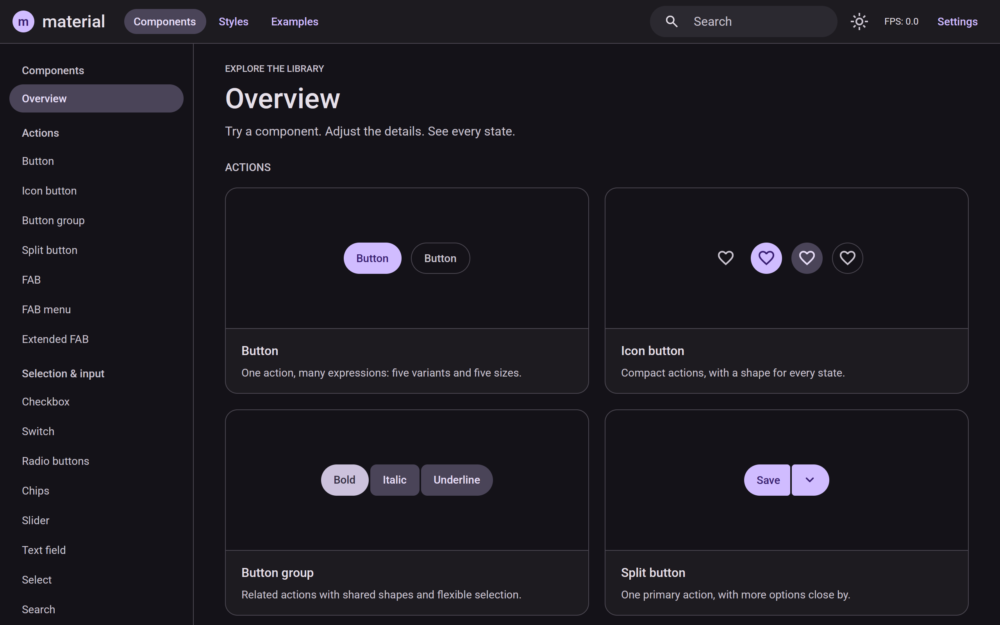

# gpui-kit-material

[](https://crates.io/crates/gpui-kit-material)
[](https://docs.rs/gpui-kit-material)
[](https://github.com/mizorewww/gpui-kit-material/actions/workflows/ci.yml)
[](LICENSE)

Material 3 and **M3 Expressive** components for Rust desktop and web apps built on
[GPUI](https://www.gpui.rs/) and [Longbridge GPUI Kit](https://github.com/longbridge/gpui-kit).

Buttons, chips, text fields, menus, dialogs, navigation, pickers and more, with
Material's color system, type scale, shapes and Expressive motion. One codebase runs
natively on macOS, Linux and Windows, and in the browser through WebAssembly.

**[Try the live Gallery →](https://material.mizore.blog/gallery/)**



## Features

- **50+ components** across actions, selection, text input, navigation, containment
  and communication: buttons and FABs, checkboxes, switches, chips, sliders, text
  fields, date and time pickers, menus, tabs, navigation rail, bar and drawer, app bars,
  cards, lists, carousels, dialogs, sheets, snackbars, progress and loading indicators.
- **Material color**: semantic color roles, the 20 md3.io reference themes in light and
  dark at three contrast levels, and dynamic schemes from a seed color
  (ported from material-color-utilities).
- **Expressive motion**: spring-based Expressive and Standard motion schemes, animated
  theme changes, and reduced motion per transition.
- **Tokens**: the 15 type roles, shape scale and shape morphing, elevation, state
  layers and layout metrics, with text scaling from 100% to 200%.
- **Material Symbols**: the full Google icon catalog through
  [gpui-material-symbols](https://github.com/mizorewww/gpui-material-symbols).
- **Built on Kit**: components are Material styling over Kit's controls, so input,
  focus, keyboard navigation, accessibility and overlays work the way Kit's do.
- **Pay for what you use**: every component group is a Cargo feature.

## Installation

Minimum Rust: **1.98**.

```toml
[dependencies]
gpui-kit = "0.9.1"
gpui-kit-material = "0.1"
```

Use the `gpui-kit` version the library depends on, so that Kit, GPUI and the icons
resolve to one implementation. No `[patch]` is needed.

To compile only the parts you use, turn off the defaults and name the component groups:

```toml
gpui-kit-material = { version = "0.1", default-features = false, features = ["buttons", "selection", "gpui-fast", "embedded-symbols"] }
```

The [crate README](crates/material/README.md#features) lists every feature.

**WebAssembly:** published Kit 0.9.1 builds its web platform with threads, which needs
the nightly toolchain named in Kit's
[WebAssembly guide](https://github.com/longbridge/gpui-kit/blob/main/website/docs/webassembly.md).

## Usage

Initialize Kit and Material, then set a theme:

```rust
use gpui_kit_material::{color::themes::{Contrast, ThemeId, ThemeMode}, icons::Assets, theme};

gpui_kit::application()
    .with_assets(Assets::new())
    .run(|cx| {
        gpui_kit::init(cx);
        gpui_kit_material::init(cx);
        let scheme = ThemeId::Baseline.scheme(ThemeMode::Light, Contrast::Standard);
        theme::init_component_theme(scheme, 1.0, cx);
        // Open windows with gpui_kit::open_window.
    });
```

Paint with color roles, so your UI follows theme and dark mode changes:

```rust
div().bg(color(ColorRole::SURFACE_CONTAINER)).text_color(color(ColorRole::ON_SURFACE))
```

Components are controlled: your view owns the state, and the component reports changes.

```rust
use gpui_kit_material::icons::IconName;

let view = cx.entity();
material_button("save", ButtonVariant::Tonal)
    .icon(IconName::Check)
    .toggle(true)
    .selected(self.saved)
    .on_change(move |selected, _click, _window, cx| {
        view.update(cx, |this, cx| { this.saved = selected; cx.notify(); });
    })
    .child("Saved")
```

Switch themes with an animated transition, or change the motion scheme:

```rust
let ocean = ThemeId::Ocean.scheme(ThemeMode::Dark, Contrast::High);
let running = theme::advance_component_theme(ocean, 1.0, window, cx);
gpui_kit_material::motion::set_motion_scheme(gpui_kit_material::motion::MotionScheme::Standard);
```

`advance_component_theme` returns `true` while the transition runs. Call it again
from a next-frame callback, not from `render`.

More: the [API documentation](https://docs.rs/gpui-kit-material) and the
[Gallery](https://material.mizore.blog/gallery/), whose
[source](crates/gallery) uses every component.

## Crates

| Crate | |
| --- | --- |
| [`gpui-kit-material`](https://crates.io/crates/gpui-kit-material) | Theme, tokens, motion, icons and components. |
| [`gpui-kit-material-color`](https://crates.io/crates/gpui-kit-material-color) | Color roles, themes and dynamic color, with no GPUI dependency. |
| [`gpui-material-symbols`](https://crates.io/crates/gpui-material-symbols) | Material Symbols for GPUI Kit. |

## Project status

**Pre-release (0.1).** Almost every component is implemented and tested, but the API
may still change and no component is marked stable yet.
[Coverage](docs/COVERAGE.md) lists each component's state and gaps, and the
[roadmap](docs/ROADMAP.md) what comes next. See the [changelog](CHANGELOG.md) for releases.

## Support

Report bugs and ask questions in [GitHub issues](https://github.com/mizorewww/gpui-kit-material/issues).

## Contributing

Pull requests are welcome. [CONTRIBUTING.md](CONTRIBUTING.md) explains how to build and
run the Gallery, run the checks, and where the design and performance rules live.

## Acknowledgments

- [Longbridge GPUI Kit](https://github.com/longbridge/gpui-kit) and
  [GPUI](https://github.com/zed-industries/zed/tree/main/crates/gpui), which this library builds on.
- Google's [Material 3](https://m3.material.io/) design and its Figma Design Kit,
  [md3.io](https://md3.io/) and [m3e.kyralabs.dev](https://m3e.kyralabs.dev/), the
  references for every token and component.
- [material-color-utilities](https://github.com/material-foundation/material-color-utilities)
  for dynamic color.

## License

MIT, except files ported from Apache-2.0 sources, which keep their notices. Material
Symbols are Apache-2.0. The Gallery's fonts are SIL OFL 1.1. See
[crates/color/PALETTES.md](crates/color/PALETTES.md) for palette sources and the
site's [license list](https://material.mizore.blog/licenses/) for every license.
