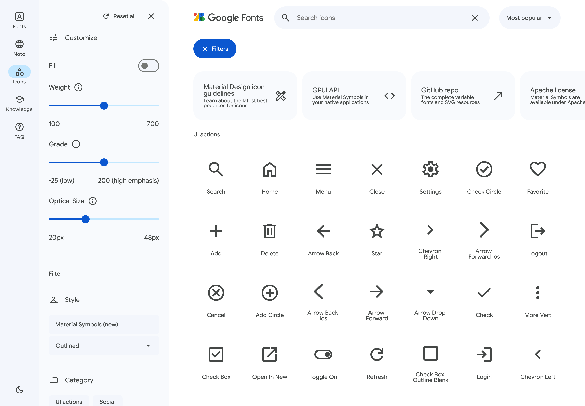

# Material Symbols browser

A native GPUI reference of [Google Fonts Icons](https://fonts.google.com/icons),
using this kit's components and the full sibling `gpui-material-symbols` catalog.
The reference desktop viewport is 1440 × 1000 logical pixels. No WebView is used.

Clone `gpui-kit-material` and `gpui-material-symbols` next to each other, then:

```sh
cd gpui-kit-material
cargo run -p gpui-kit-material --example material_symbols
```

The example uses the symbol crate without its optional `gpui-component` adapter;
its `AssetSource` renders symbols directly into this kit's GPUI version. The
symbol crate's own optional adapter follows `longbridge/gpui-kit` main.



[Dark theme](screenshots/material-symbols-dark.png) · [GPUI details](screenshots/material-symbols-detail.png)

## Interactions

- All 4,359 catalog names, virtualized and grouped by category, including names
  missing from Google Fonts' public search metadata (under Other).
- Name/tag search, popularity/name sorting, category selection and reset.
- Outlined, Rounded and Sharp; fill, weight, grade and optical-size controls.
- Light/dark themes, collapsible filters, animated non-modal details sheet.
- Preview size/color, SVG and PNG file export with those dimensions/colors.
- Copyable Rust/GPUI API reflecting the selected style and all four axes.

Web, Android and Apple installation tabs are replaced with GPUI instructions.
The legacy Material Icons family is outside the Material Symbols catalog.
SVG-only names show an explicit unavailable state for unsupported axis
combinations; the app does not silently substitute a different icon variant.
The metadata is a snapshot, so live popularity/new releases can change upstream.

## Components

Reusable implementations live in `src/components/controls.rs`, and each appears
in `examples/gallery.rs`. Geometry was checked against [md3.io](https://md3.io/components):
52 × 32 switch with 16/24 thumb, 56-high search field, pill buttons, and a standard
side sheet. `MaterialSlider` offers the classic Google Fonts appearance and
an expressive 16-high track with a 4 × 44 handle. Behavior and accessibility
come from GPUI Base. Colors use semantic roles, geometry uses rems, switch/sheet
motion uses the kit's retargetable springs and respects reduced motion.

The expressive slider is the single-value variant; range sliders, tick marks and
value bubbles are not provided by this component. The browser uses Classic.

## Verification and captures

```sh
cargo fmt --all --check
cargo clippy --workspace --all-targets -- -D warnings
cargo test --workspace
cargo test -p gpui-kit-material --example material_symbols
cargo run -p gpui-kit-material --example material_symbols -- --capture /tmp/material-symbols
```

The capture command renders light, dark, details and search states through the
native GPUI headless renderer. On macOS this requires a working Metal device.
Interaction tests exercise actual input/click dispatch, including disabled
controls, sort selection, opening/closing details, empty results and clearing
search. Export tests decode the PNG and check dimensions and pixel colors.

## Assets and provenance

- Symbol shapes: sibling crate's pinned Google Material Symbols snapshot;
  Apache 2.0, with its license retained in that repository.
- Categories, tags and popularity: Google Fonts
  `https://fonts.google.com/metadata/icons?key=material_symbols&incomplete=true`,
  fetched 2026-10-29. Refresh using `python3 scripts/update-symbol-catalog.py`.
  Whitespace is normalized so tags cannot corrupt TSV columns.
- Google Sans Flex: [google/fonts](https://github.com/google/fonts/tree/main/ofl/googlesansflex),
  distributed with `assets/OFL.txt` under SIL Open Font License 1.1.
- Google Fonts logo: SVG from the reference site's header, retained solely to
  reproduce the requested reference example. Google branding is not the kit's
  identity and is not covered by this project's MIT license.

The reusable kit remains MIT; these third-party assets retain their own terms.
